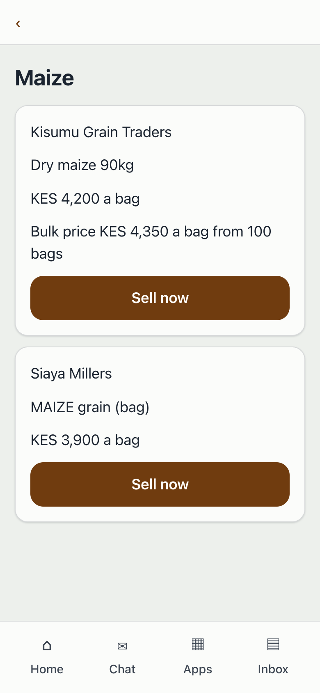
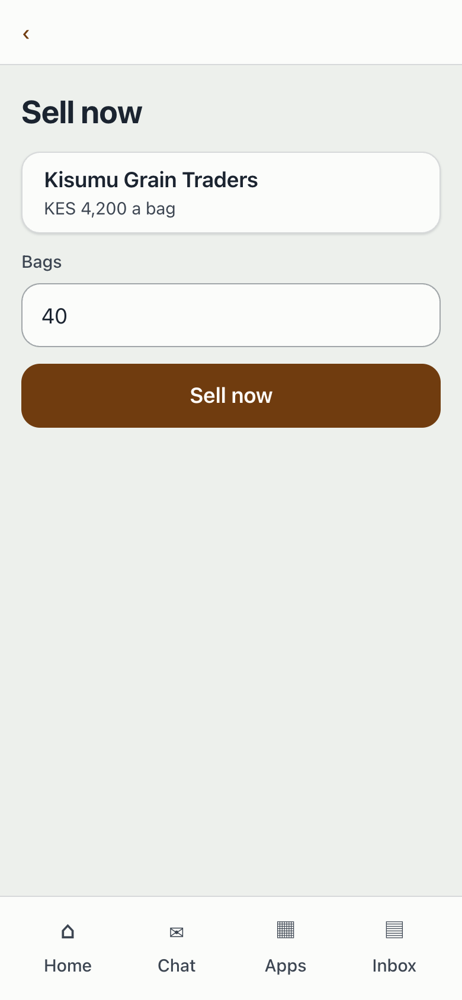
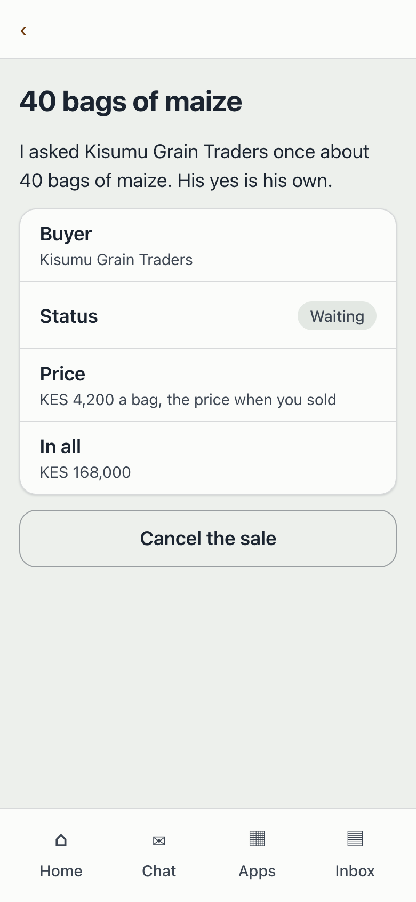
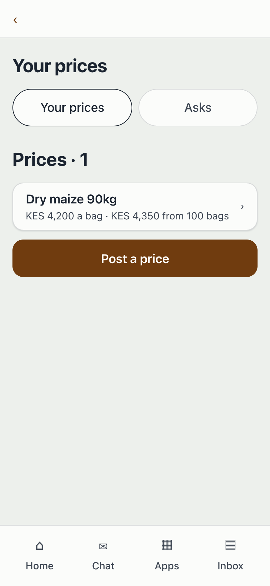

# Sell the harvest

**Goal:** Sells the harvest to a buyer, alone or together with other farmers.

**Result:** Farmers see what each buyer pays and choose; buyers post their price and answer.

**Who:** The farmer or buyer

The setting is the farmers' agency, one example agency among the demo's eight.

A farmer compares what each buyer pays for her maize, sells now or joins a group sale for the bulk price, and a buyer posts prices and answers the farmers' asks.

Mockups: [all steps in order](../../../2.%20design/mockups/journeys/16-sell-the-harvest/index.html).

## Steps

### 1. Sees the buyers' prices and sells now

Asha Otieno opens the Sell harvest row on Start, which she opens from Home, and the Farmers' agent asks what she wants to sell. She says maize and gets the best buyer first: what each buyer pays for a 90 kg bag, for example Kisumu Grain Traders at KES 4,200 a bag and KES 4,350 from 100 bags, and the group sale that is open. She chooses Sell now, enters 40 bags and sells at the price shown. The agent asks the buyer once; the yes is the buyer's own, and until it comes the ask simply has no answer yet. After the yes her sale shows 40 bags, the price it was made at, KES 168,000 in all and the date the buyer gave, Friday, 6 Nov, with a line saying who was asked and that the buyer said yes, and a Cancel the sale button.

Mockup: [step-01-sees-prices-and-sells-now.html](../../../2.%20design/mockups/journeys/16-sell-the-harvest/mockups/step-01-sees-prices-and-sells-now.html)

### 2. Sells together with other farmers

From the buyers' prices Asha opens the open group sale: Kisumu Grain Traders at KES 4,350 a bag from 100 bags, 62 bags so far from 6 farmers. She joins with 40 bags under the terms it started with, and then sees her own line and the new total of 102 bags and 7 farmers, and no other farmer's name or amount. Once the sale has gone to the buyer and the buyer says yes, it shows as confirmed (no screen sends a group sale yet; see Not yet built): her share of 40 bags at KES 4,350 a bag, KES 174,000 in all, with the day to collect, Friday, 6 Nov, and the buyer's note.

Mockup: [step-02-sells-together.html](../../../2.%20design/mockups/journeys/16-sell-the-harvest/mockups/step-02-sells-together.html)

### 3. The buyer posts a price and answers an ask

Kisumu Grain Traders opens Your prices and sees the asks waiting, for example Asha Otieno with 40 bags of maize ready, beside the prices it has posted. Post a price takes the product in the buyer's own words, the unit, the price and the bulk price from a number of bags. An ask shows the farmer's name and bags and no contact details, the buyer's price and the total, KES 168,000. The buyer answers with their own button, Yes or No; Yes asks for a date to collect and a note. After Yes the ask shows 40 bags from Asha Otieno, the date, the note and KES 168,000 at KES 4,200 a bag.

Mockup: [step-03-buyer-posts-a-price-and-answers.html](../../../2.%20design/mockups/journeys/16-sell-the-harvest/mockups/step-03-buyer-posts-a-price-and-answers.html)

## Not yet built

- Sending a group sale. The coordinator's Send the order in [journey 18](../18-run-a-group-order/README.md) lists buying orders only (the app keeps orders whose direction is buy), and no other screen sends a sale to the buyer. The confirmed group sale in step 2 is what the walk test draws by setting the sale closed with a date.
