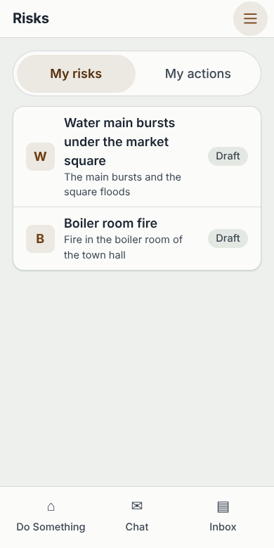
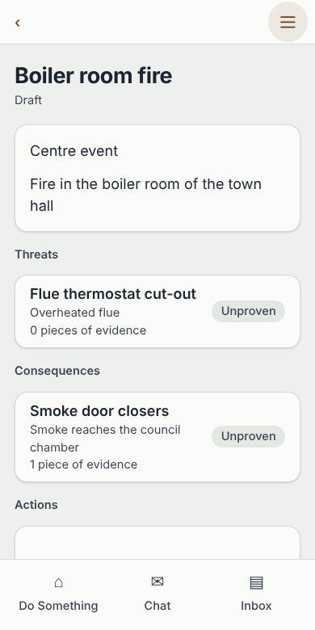
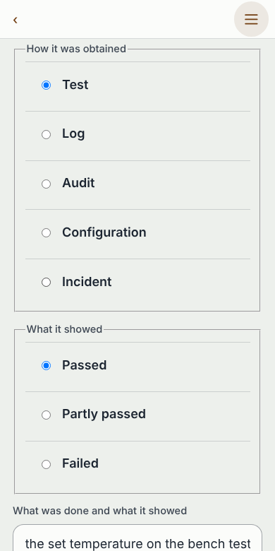
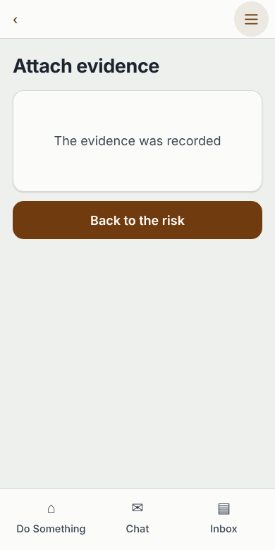
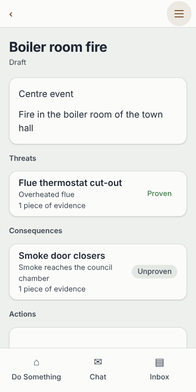

# Municipality risk module, live walk

Run on 2026-11-07 in a cloud container. The API was built from `code/wakala-api` (working tree) and run on port 8082 against the native Postgres on `127.0.0.1:54322` (repository migrations applied, no Docker). The agency is `demo/municipality.json`, imported once with `POST /instances/import` (riskmanager mounted at `risks`, taskmanager at the board, workflows W-61 to W-64). The console login was made with `POST /auth/credentials` and a session taken with `POST /auth/signin`. No row was edited in the database by hand; every change below is an API tool call or a screen action. All names are synthetic.

Method: the risk and board tools are called through the API's `/mcp` endpoint (the same tools the phone app calls). The phone app was served with its dev server on port 5171 and driven with Playwright (chromium, 390 by 780, scale 1). The app's emailed-link sign-in needs the local sign-in service, which is not running, so the run stands in for it: the browser's requests to the API are forwarded with the console session cookie, and `/me` and `/me/agencies` are answered by the script (the officer is the directory actor that owns the risk). The app screens, the tool calls and the answers are real.

## Result per moment

| Moment | Result | How |
|---|---|---|
| 1. An officer adds a risk and its safeguards | Pass | API for the adding, UI for reading it back |
| 2. Evidence moves the standing, old proof goes stale | Pass | API for the stale and failing cases, UI for a passing report |
| 3. A gap becomes a board task and closes | Pass with a manual step | API only (the app has no screen for it) |
| 4. The meeting pack shows failing safeguards and overdue actions | Pass for the data, no pack screen | API only (no screen builds the pack) |

## Moment 1: add a risk and its safeguards

| Step | Call | Result |
|---|---|---|
| Owner that the directory does not know | `riskmanager_risk_create` with owner `nobody` | Refused: `the risk's owner "nobody" is not someone the owner register knows` |
| Owner | `actor_create_actor` | Directory actor "Ilona Department Head" (AC-2) |
| Risk | `riskmanager_risk_create` | "Water main bursts under the market square", owner Ilona, status `draft` |
| Two threats, one consequence | `riskmanager_pathway_create` x3 | Pressure surge at night, Corroded joint, Stalls and cellars flood |
| Three controls | `riskmanager_control_create` x3 | Pressure relief valve, Joint inspection round, Flood barrier boards |
| Safeguards | `riskmanager_barrier_place` x3, then `riskmanager_barrier_update` (design and coverage adequate, retest after 30 days) | All three read back in `riskmanager_risk_bowtie` |
| Standing before any proof | `riskmanager_preventive_measure_list`, `riskmanager_mitigating_measure_list` | All three `unproven`, 0 evidence |

Screens (a second risk, "Boiler room fire", built the same way): the officer's list shows only the risks they own; the risk screen shows each safeguard with its pathway, its count of evidence and its standing.

## Moment 2: evidence, standing, stale

| Step | Result |
|---|---|
| Pass report on the relief valve (`riskmanager_evidence_record`) | Standing `unproven` to `proven`, 1 evidence |
| Pass report dated 90 days ago on the joint round (retest 30 days) | Counts 1 evidence, standing stays `unproven`; the gap list gains `barrier_stale` (medium): "the latest evidence ... was recorded 2026-08-09 ..., more than the 30 day(s) it stays current" |
| Fail report on the flood boards | Standing `failing`; gap `barrier_failing` (high) |

In the app the officer opens a safeguard, picks how it was obtained and what it showed, writes what was done and sends it. The record is made and the risk screen then reads `Proven` for that safeguard.

On that last screen the second safeguard has old proof (90 days) and shows "Unproven" with "1 piece of evidence". The app does not say the proof is old: a stale safeguard and a never-tested one look alike except for the count.

## Moment 3: a gap becomes a board task and closes

| Step | Result |
|---|---|
| Gap read | `riskmanager_gap_list`: `barrier_stale` on the joint inspection round |
| Board task | `taskmanager_task_create`: "Re-test the joint inspection round", due in 14 days, state "To do" |
| Risk action linked to it | `riskmanager_action_create` with `task_ref` set to the task id, owner Ilona, status `open` |
| Task worked and finished on the board | `taskmanager_task_move` to "Doing", then "Done"; the task reads `completed` |
| The action after the task is done | Still `open`. Nothing marks it done |
| Officer closes the action | `riskmanager_action_set_status` `done`, `closed_at` set |
| Re-test recorded | A new pass report on the joint barrier: standing `proven`, 2 evidence; the `barrier_stale` gap leaves the list |

Does the known gap break "no manual edit"? Not as a database edit: the action is closed by an ordinary tool call that the officer is meant to make (WI-63-5),. It does break a stricter reading, "no human step that the system could do": the board task finishing does not close the action, so an action can stay open and later show as overdue after its task is done. Also, the gap leaves the list because new proof arrived, not because the action or task closed.

Not covered by a screen: the app has no screen for gaps, tasks or actions beyond a read-only list on the risk.

## Moment 4: the meeting pack

Data a pack needs, read in one sequence (after adding an action "Repair the east corner seal" with a due date of 2026-09-30):

| Part | Answer |
|---|---|
| Failing safeguards | `Flood barrier boards` (consequence, 1 evidence, `failing`) |
| High gaps | `barrier_failing` on the flood boards; `action_overdue` on the repair action |
| Overdue actions | "the work "Repair the east corner seal" was due 2026-09-30T00:00:00Z", risk and owner present |
| Overdue board tasks (`taskmanager_task_list_overdue`) | none: the only board task had been completed |

Not covered: there is no screen or export that assembles the pack, so W-64's pack is the three calls above. The closed task from moment 3 does not appear on the overdue list, as it should not.

## Gaps found

- riskmanager has no top-risks ranking. The pack can list risks, gaps and overdue actions, not the ten worst risks. `riskmanager_risk_list` has no order or rating filter.
- Completing a board task does not mark its risk action done (see moment 3).
- A risk action's `task_ref` is not checked against the board. The registry builds the risk manager with an owner check only; `WithTasks` is not wired, so any string is accepted. The unit test with a fake task register shows the check exists in the module.
- Over plain HTTP, `GET` and `POST /instances/{id}/risks` are answered by the agency's draft risk routes, which want a draft id ("a draft id is required"); the register's own routes are only reached through `/mcp`. The app uses `/mcp`, so nothing in the product breaks, but the register has no working plain HTTP path.
- A risk stays `draft` unless someone calls `riskmanager_risk_set_status`; nothing in the walk moves it.
- The app cannot tell old proof from no proof (moment 2).
- The app sign-in by emailed link was not exercised (no sign-in service); the walk stands in for it as described above.
- A test task named "probe" was left on the board of the local agency by a schema check. It is only in the local database.

No code was changed, so no regression test was added.
