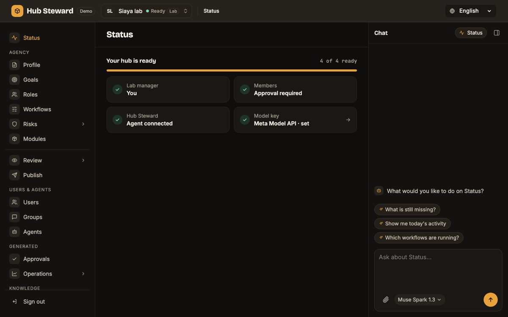
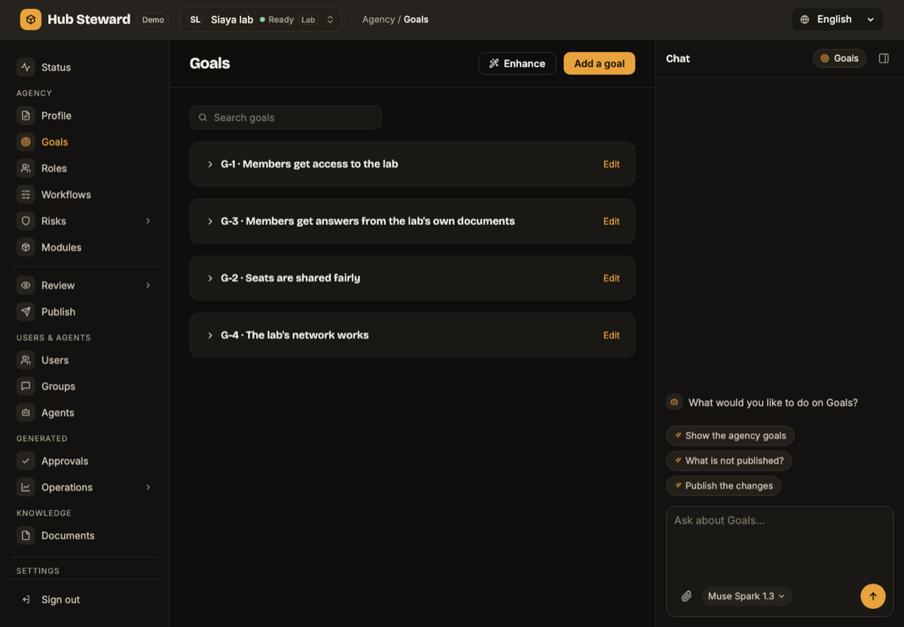
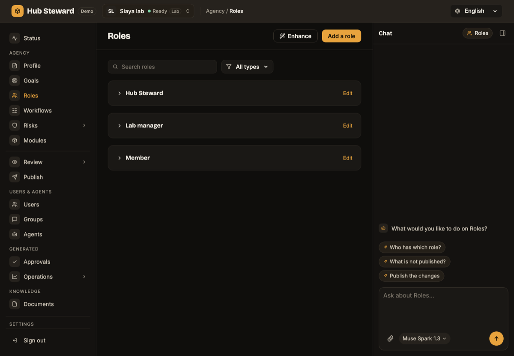
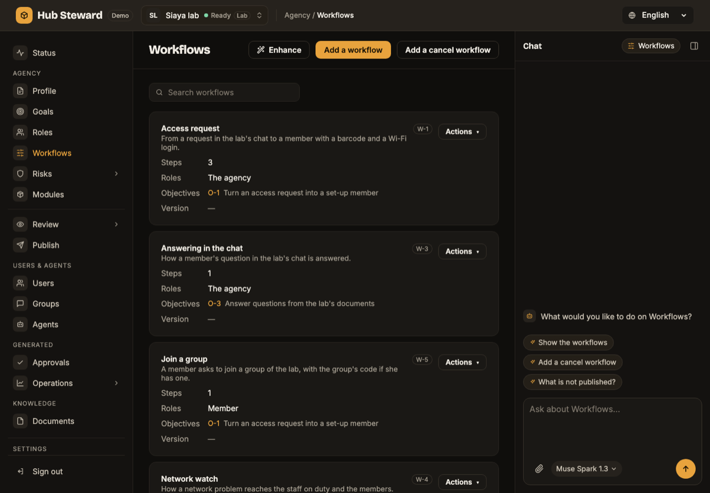
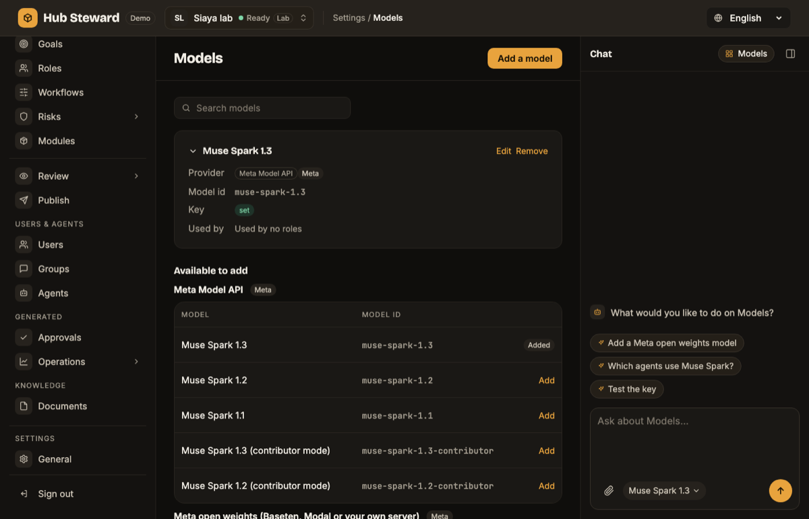
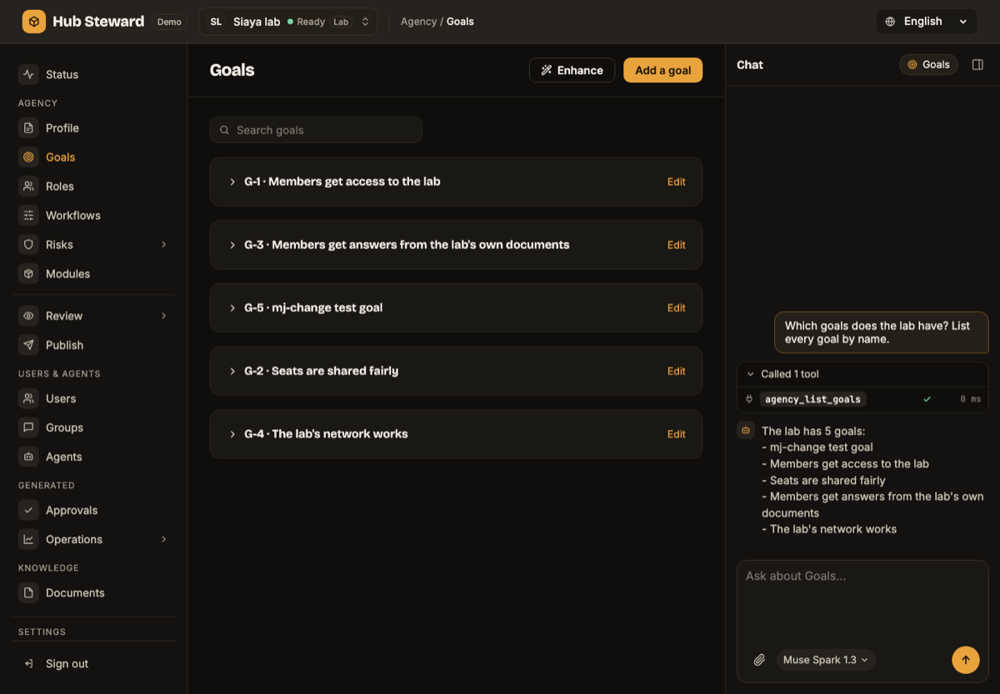
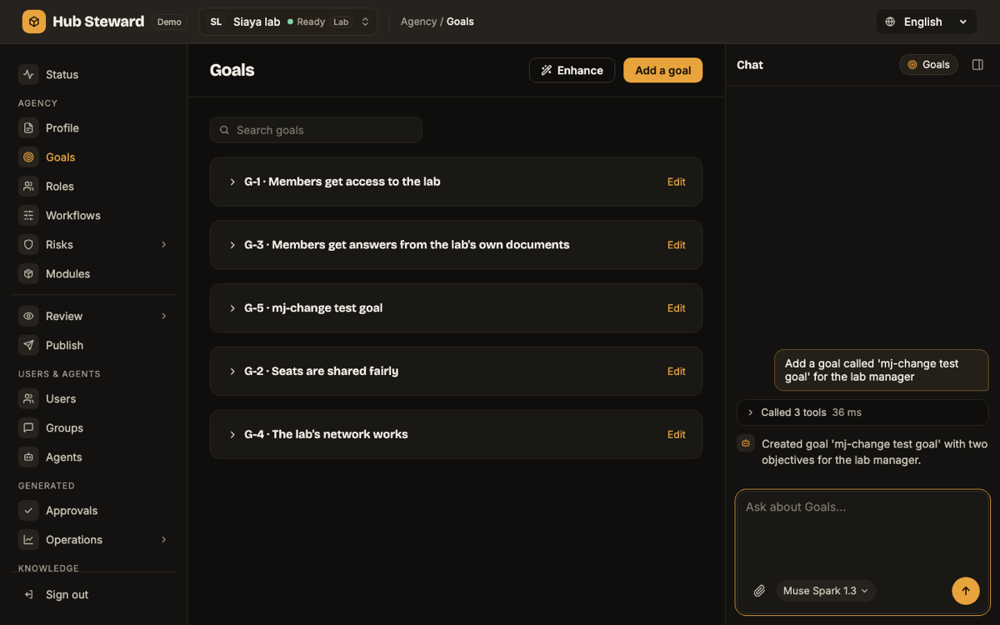
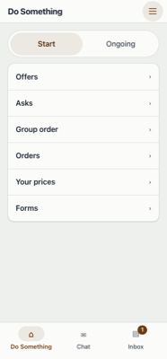
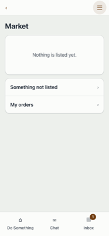
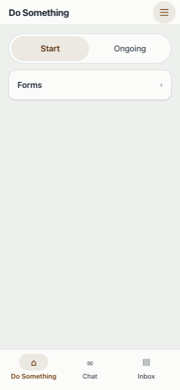

# Screenshots from the test runs

Taken on 4 November 2026 while running the journeys in [the results](../02-results/README.md): the console and the phone app against a local Supabase database, with the Siaya lab and the Siaya Farmers' Group imported by `scripts/local-setup.sh --demos`, and the Meta model Muse Spark 1.3 set as the hub's model. No key appears in any picture.

## Console

| Picture | What it shows |
|---|---|
|  | The Siaya lab's Status page: four of four ready, with "Model key: Meta Model API · set" |
|  | The lab's goals, with the chat column on the right |
|  | The lab's roles |
|  | The lab's workflows |
|  | The Models page: Muse Spark 1.3, its key shown only as "set" |

## Chat with the model

| Picture | What it shows |
|---|---|
|  | On the Goals page the chat calls the hub's goals tool and lists every goal by name |
|  | The chat adds a goal named in the request, and the goal appears in the list |

The goal named "mj-change test goal" was added by a test run, not part of the demo content.

## Phone app

| Picture | What it shows |
|---|---|
|  | A supplier's Do Something tab in the Farmers' Group: Offers, Asks, Group order, Orders, Your prices, Forms |
|  | The market page |
|  | A member of the Siaya lab after signing in with the emailed link |

## What these pictures do not show

Findings from the same runs are in the results pages. Two matter to anyone repeating the run: on a hub made by the demo import, the Approvals page and the console's Save do not work yet, and the phone app has no assistant for members.
