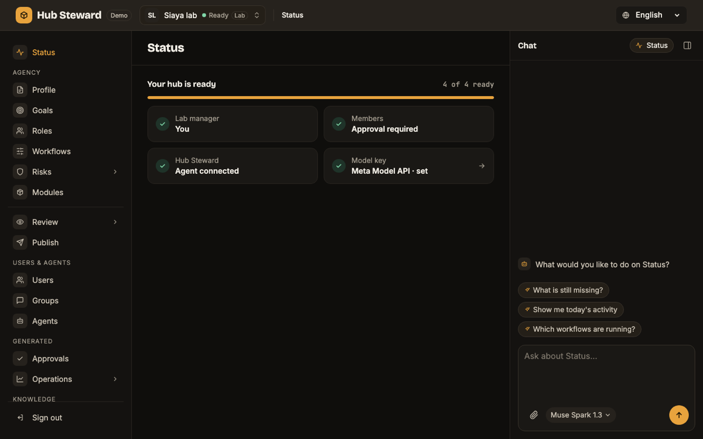
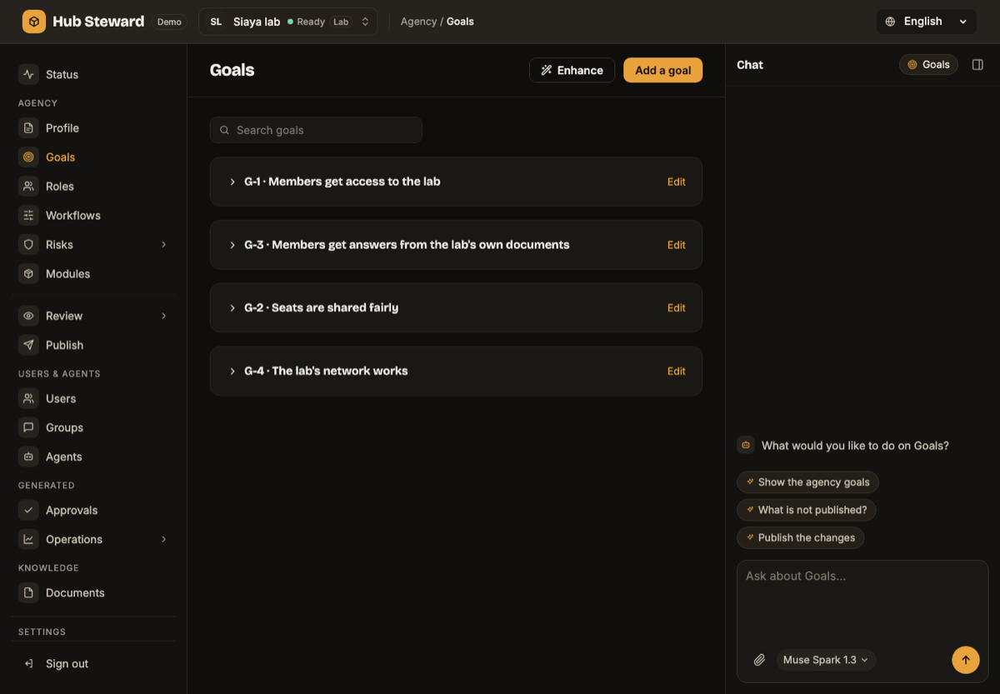
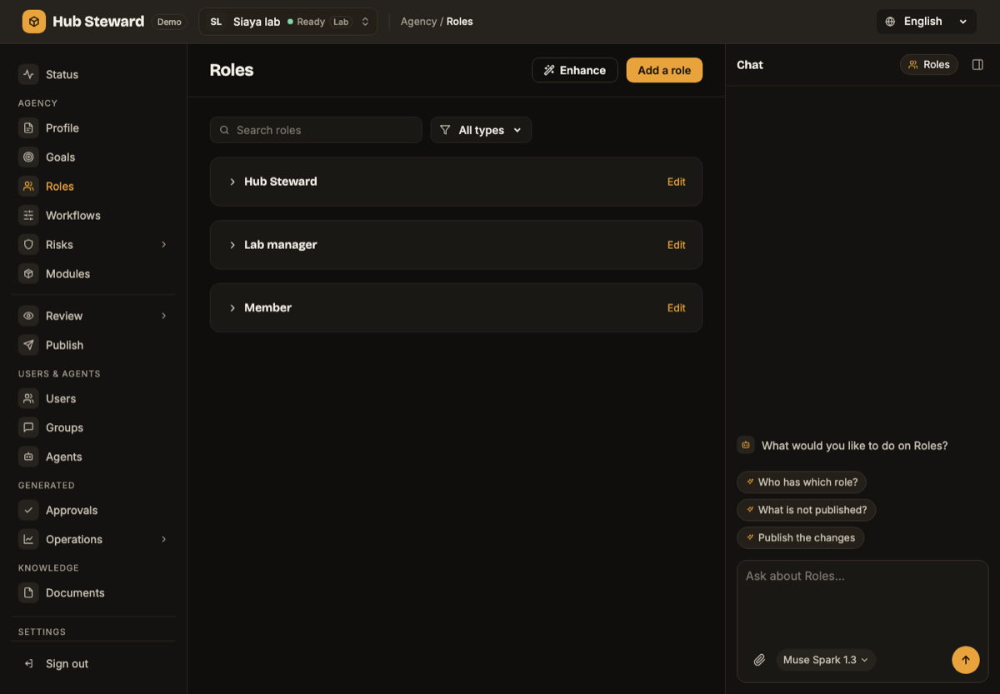
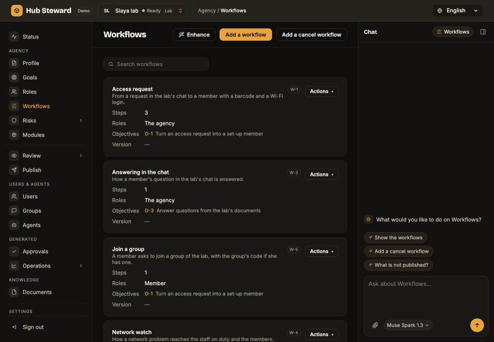
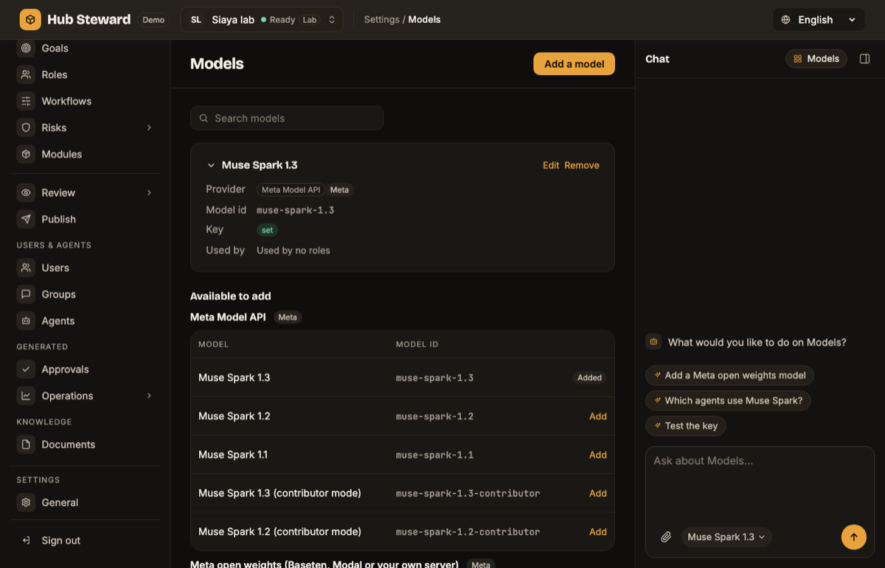
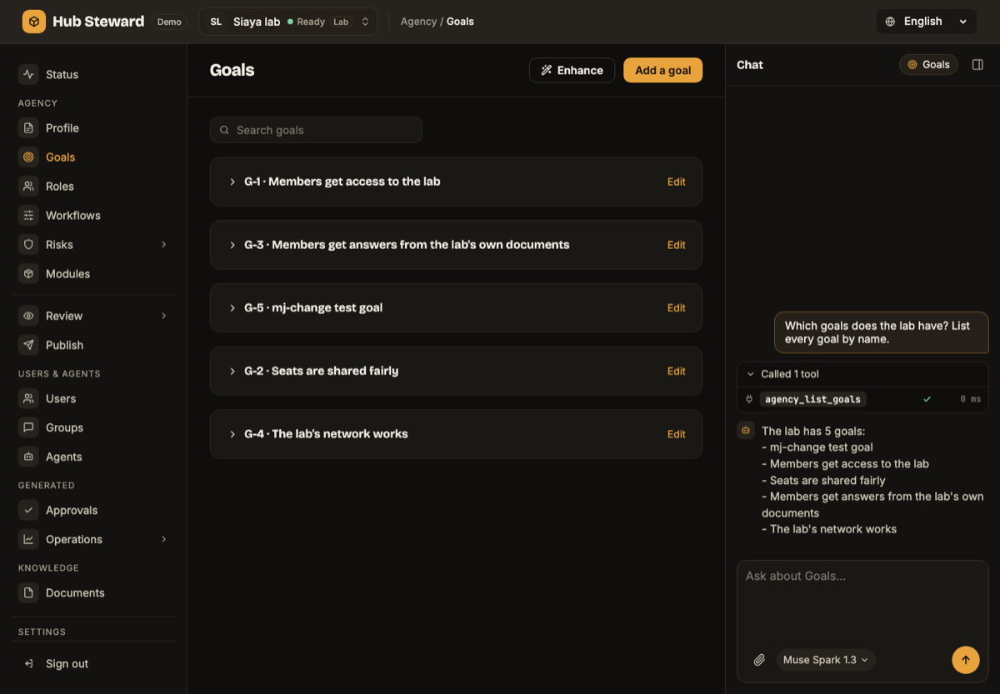
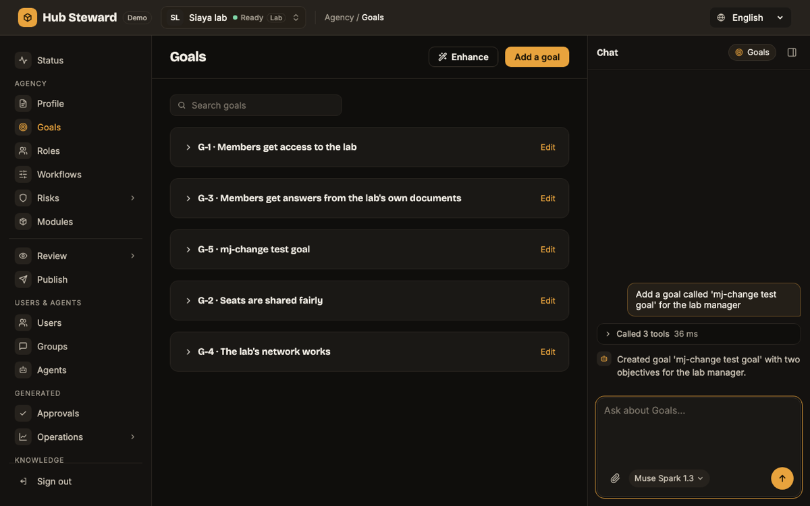
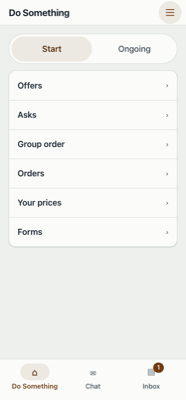
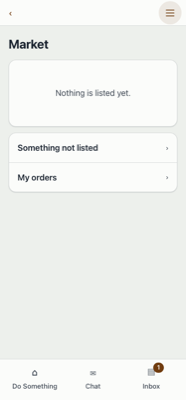
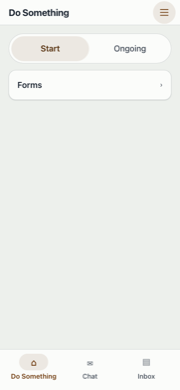

# Screenshots from the test runs

Taken on 4 November 2026 while running the journeys in [the results](../02-results/README.md): the console and the phone app against a local Supabase database, with the Siaya lab and the Siaya Farmers' Group imported by `scripts/local-setup.sh --demos` (the script is in the repository from 11 November 2026; the run of 4 November made the same calls by hand), and the Meta model Muse Spark 1.3 set as the hub's model on the console's Models page. No key appears in any picture.

## Console

| Picture | What it shows |
|---|---|
|  | The Siaya lab's Status page: four of four ready, with "Model key: Meta Model API · set" |
|  | The lab's goals, with the chat column on the right |
|  | The lab's roles |
|  | The lab's workflows |
|  | The Models page: Muse Spark 1.3, its key shown only as "set" |

## Chat with the model

| Picture | What it shows |
|---|---|
|  | On the Goals page the chat calls the hub's goals tool and lists every goal by name |
|  | The chat adds a goal named in the request, and the goal appears in the list |

The goal named "mj-change test goal" was added by a test run, not part of the demo content.

## Phone app

| Picture | What it shows |
|---|---|
|  | A supplier's menu in the Farmers' Group, drawn before Start moved to Home (D154): Offers, Asks, Group order, Orders, Your prices, Forms |
|  | The market page |
|  | A member of the Siaya lab after signing in with the emailed link |

## Menu drawings

Taken by the Menu journeys in [Menu journeys](../01-test-plan/menu-journeys.md) from the static drawings under `documentation/2. design/mockups/app/`, one picture per step, in `menu/<folder>/`. They are pictures of drawings with sample data, not of the running app.

| Folder | What it shows |
|---|---|
| `menu/00-smoke/` | The first Home drawing, taken once to check the setup |
| `menu/00-home/` | Home with a row for each section, a section with one screen, a section that opens the forms, nothing built yet, and the Home of a smaller agency |
| `menu/01-residents/` | Residents: the submenus, All Residents, a resident, Households, Registrations, Groups & Associations, Communications |
| `menu/02-properties/` | Properties & Addresses: Home, the properties list, a property, Addresses, Ownership & Tenure, Land Use & Zoning |
| `menu/03-issues/` | Issues & Requests: Home and the section screen so far; the rest follow when the journey is finished |
| `menu/06-council/` | Council & Decisions: Home, Meetings, a meeting, Agendas & Minutes, Resolutions, Bylaws, Committees |
| `menu/07-staff/` | Staff & Departments: Home, Staff, a staff member, Departments, Crews, Roles & Permissions |

The folders for Services & Permits, Assets & Works, Finance and Settings are added when their journeys have pictures.

## What these pictures do not show

Findings from the same runs are in the results pages. Two matter to anyone repeating the run: on a hub made by the demo import, the Approvals page and the console's Save do not work yet, and the phone app has no assistant for members.
