# Menu drawings, review sheet

7 journeys, 32 pictures.

## Home

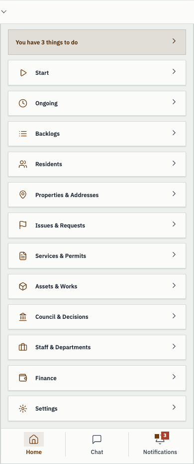

`01-home-with-the-sections.png`

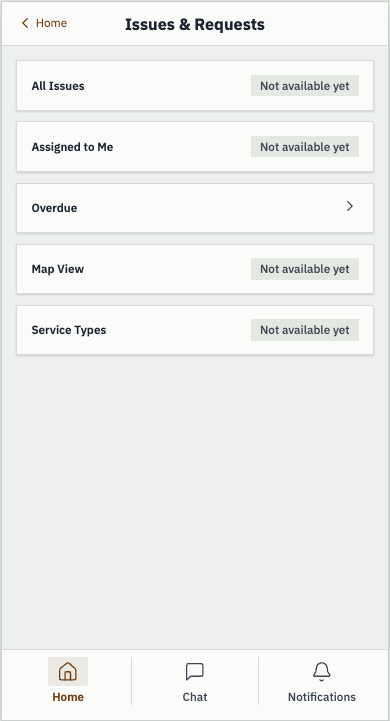

`02-section-with-one-screen.png`

`03-section-that-opens-the-forms.png`

`04-nothing-built-yet.png`

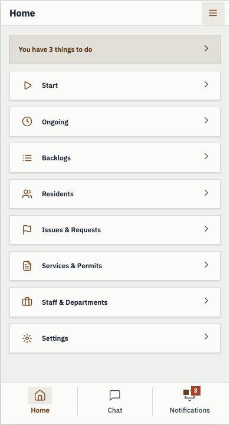

`05-home-of-a-smaller-agency.png`

## Residents

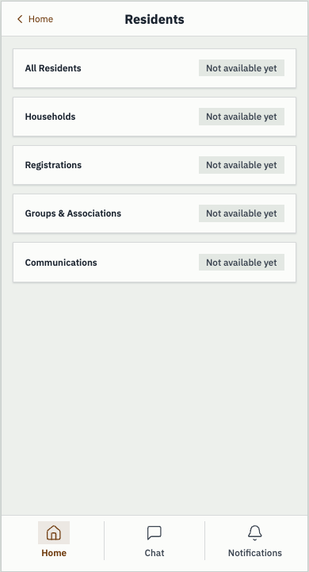

`01-residents-submenus.png`

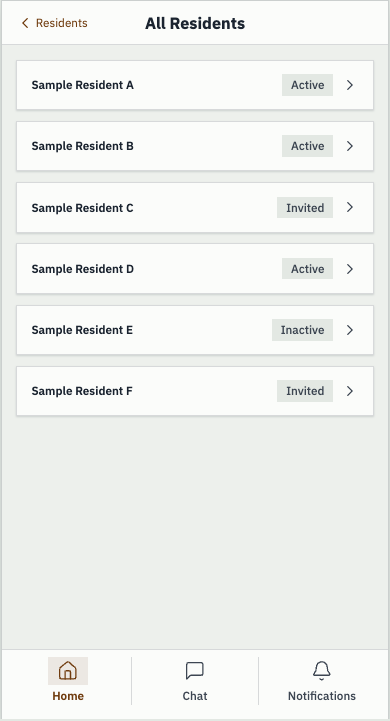

`02-all-residents.png`

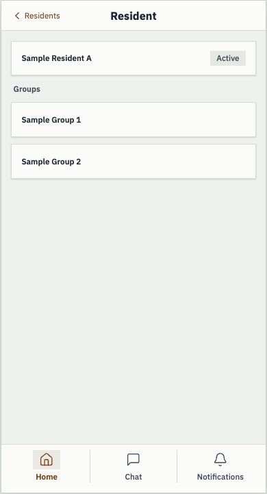

`03-a-resident.png`

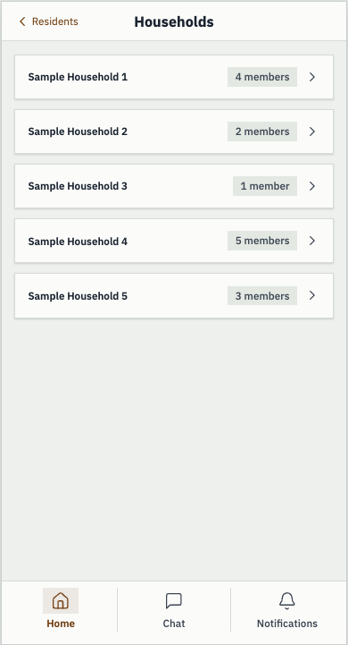

`04-households.png`

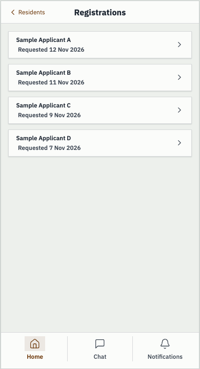

`05-registrations.png`

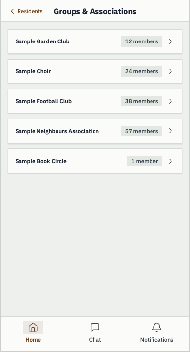

`06-groups-and-associations.png`

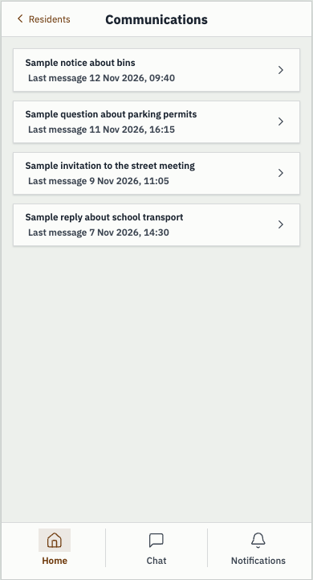

`07-communications.png`

## Properties

`01-home.png`

## Issues

`01-all-issues.png`

`02-an-issue.png`

`03-assigned-to-me.png`

`04-overdue.png`

`05-map-view.png`

`06-service-types.png`

## Council

`01-home-lists-council-and-decisions.png`

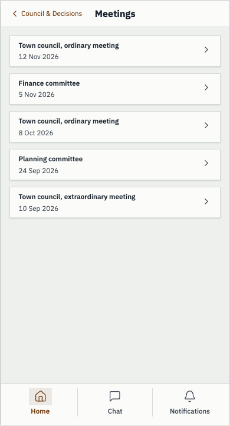

`02-meetings-list.png`

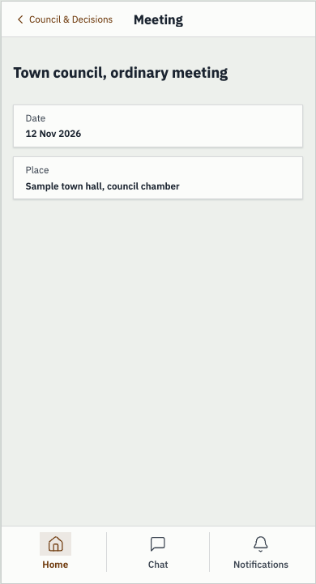

`03-a-meeting.png`

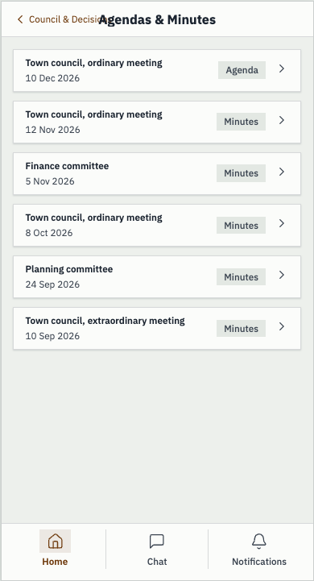

`04-agendas-and-minutes.png`

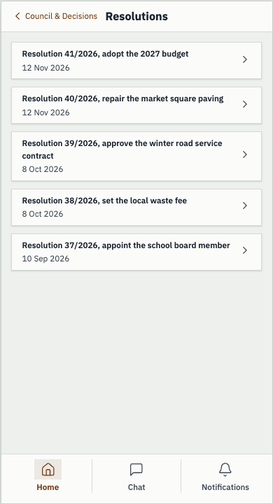

`05-resolutions.png`

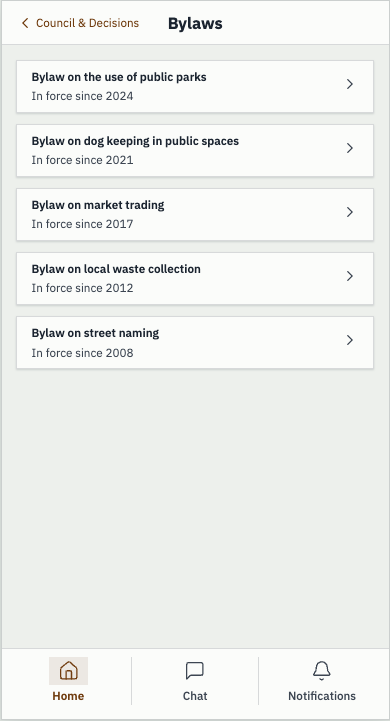

`06-bylaws.png`

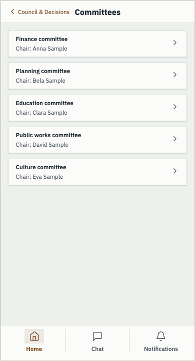

`07-committees.png`

## Staff

`01-home-lists-staff-and-departments.png`

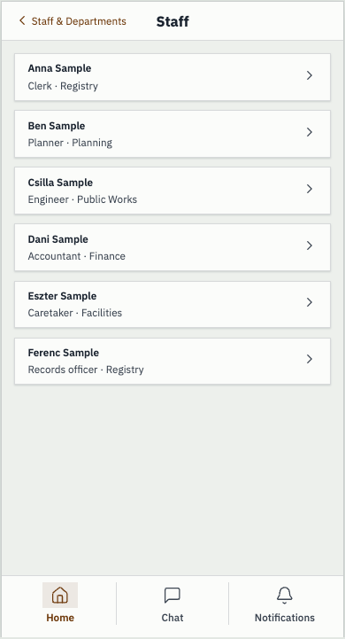

`02-staff-list.png`

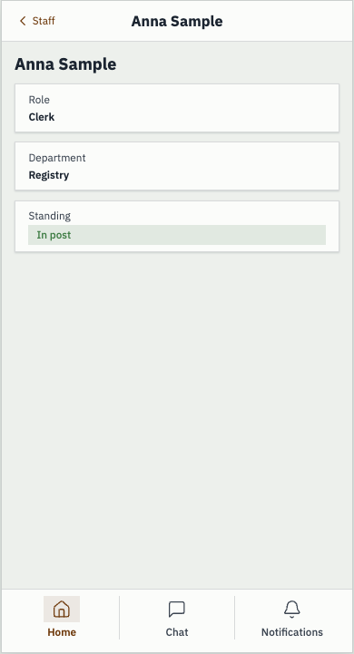

`03-a-staff-member.png`

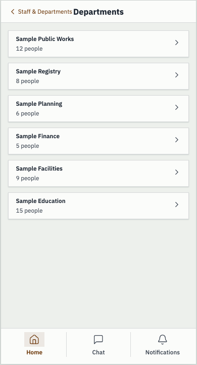

`04-departments.png`

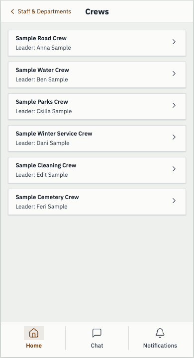

`05-crews.png`

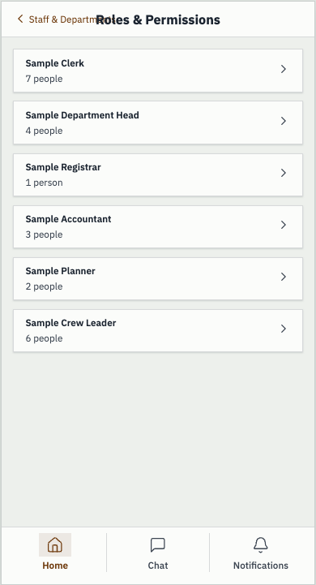

`06-roles-and-permissions.png`

## Finance
